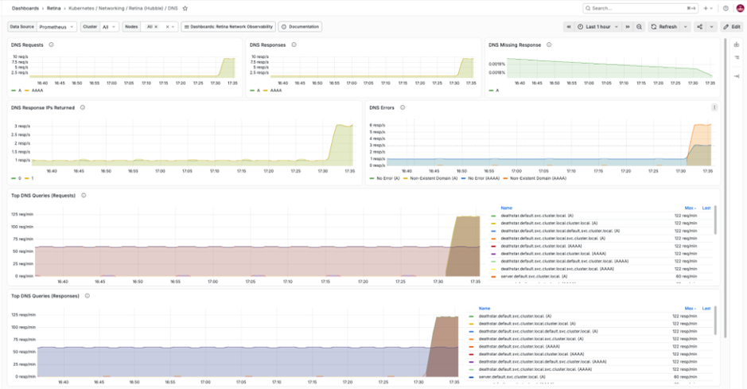
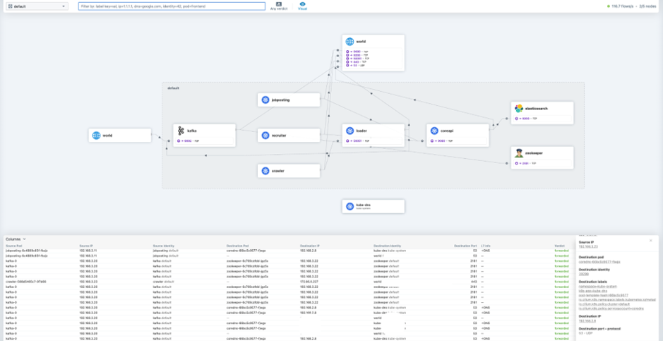
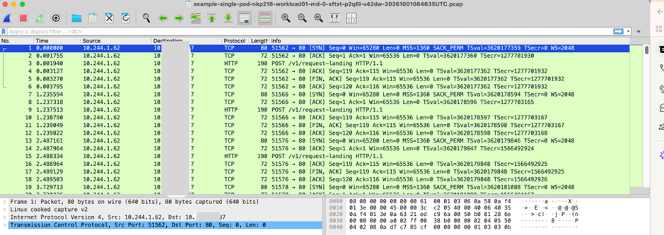

Most Kubernetes teams no longer run a single cluster on a single platform. A typical estate includes managed clusters in one or more public clouds, distributions running on-premises, and edge or sovereign environments, often with a different Container Network Interface (CNI) in each. The networking layer differs from place to place, but the questions operators ask during an incident are always the same: Which pods are talking to each other? Where are packets being dropped? Is it DNS? What actually happened on the wire?

Network observability has often been tied to a particular data plane. The richest eBPF-based tooling grew up alongside specific CNIs, and Hubble is a good example: it has historically been tightly coupled with Cilium. If your platform uses a different CNI, you have two choices. You can give up that depth of visibility, or you can re-architect your networking to get it. For a platform vendor with an established, production-proven data path, neither choice works.

Retina was built to remove that trade-off by decoupling observability from data plane. This post covers how Nutanix used Retina to add eBPF-powered network observability to the Nutanix Kubernetes Platform (NKP) and its OVN-Kubernetes-based Flow CNI.

<!-- truncate -->

## Retina: a portable observability layer

Retina is an open-source Kubernetes network observability platform created by Microsoft, built on one idea: observability should be decoupled from the data plane. It is:

- **Cloud-agnostic:** It runs on any cloud or on-premises Kubernetes distribution, including Azure Kubernetes Service, where it powers Advanced Container Networking Services.
- **CNI-agnostic:** It uses eBPF kernel hooks rather than CNI internals, so it works alongside Microsoft Azure CNI, AWS VPC CNI, OVN-Kubernetes and others, producing the same metrics on each.
- **Hubble-compatible and more:** Retina can use Hubble as its control plane, bringing familiar Hubble flows, CLI, UI, and Prometheus metrics to clusters that don't run Cilium. It also adds troubleshooting and observability capabilities beyond Hubble, including Retina packet capture, integration with pwru for deep kernel-level packet tracing, and DNS metrics that don't depend on FQDN network policies being configured.

## The Nutanix challenge: deep visibility, same data path

Nutanix Flow CNI is the native CNI for the Nutanix Kubernetes Platform (NKP). It is built on OVN-Kubernetes and integrates with Nutanix's established OVS-based networking. Customers use NKP for everything from stateless microservices to stateful applications and AI workloads, and they expect the same depth of network visibility they would get anywhere else.

The Nutanix Flow team set out a clear requirement. They wanted an eBPF-based observability solution that would work seamlessly with their existing OVN-Kubernetes offering. Replacing the CNI to gain observability was never an option. The networking architecture was a deliberate product decision, and customers rely on it.

> "We were looking for an observability solution that would let us continue to use our CNI solution that relies on OVN-K controlled OVS based data plane. Microsof-backed Retina ticked all the boxes. Retina makes the same rich metric set that the Hubble control plane provides, ranging from L4-L7, DNS and interface statistics available to K8s deployments with Nutanix's Flow CNI. This is invaluable to us and our customers."
>
> — **Aniket Daptari, Sr. Director of Product Management at Nutanix**

## Bringing eBPF-Powered Observability to Flow CNI

Nutanix integrated Retina with Flow CNI to bring eBPF-powered network observability to NKP without requiring customers to change their networking stack. This gives Nutanix a portable observability layer while allowing Flow CNI to remain the Kubernetes data plane.

### Metrics at node and pod level

Nutanix uses Retina to produce two types of network metrics:

- **Node-level metrics** (`networkobservability_*` prefix) provide visibility into traffic volume, dropped packets, connection statistics, and other network behavior at the node level.
- **Pod-level and DNS metrics** (`hubble_*` prefix) include source and destination pod context. They cover DNS queries and responses, L4/L7 flows, drops and TCP flags.

Nutanix exposes these metrics through Prometheus and uses them to build Grafana dashboards that give NKP users a consolidated view of network health and application connectivity. This helps users investigate scenarios such as DNS failures, increased packet drops, or unexpected changes in traffic between workloads.

<!-- IMAGE PLACEHOLDER 1: Add your Grafana screenshot to ./images/nutanix-grafana-dashboard.png, then uncomment the line below. -->

### Flow visibility with the Hubble experience

Nutanix also uses Retina's Hubble integration to provide real-time visibility into service-to-service communication on Flow CNI clusters.

With Hubble CLI and Hubble UI, NKP users can filter flows by workload, namespace, protocol, or other Kubernetes context rather than relying only on node-level networking tools. For example, users can trace DNS requests from a pod and see NXDOMAIN responses generated during search-domain expansion before the successful DNS response.

This gives operators a Kubernetes-aware view of what is happening between workloads while Flow CNI continues to provide the underlying networking.

### Distributed packet capture without SSH

Nutanix also adopted Retina's distributed packet capture capabilities to simplify deeper network troubleshooting in NKP.

Instead of requiring administrators to SSH into individual worker nodes, run tcpdump, collect PCAP files, and manually correlate results across nodes, Retina allows NKP users to initiate targeted or cluster-wide captures through Kubernetes APIs.

Alongside packet captures, Retina can collect additional diagnostic context, including:

- IPTables rules
- Routing tables
- Socket statistics
- Network configuration metadata

For Nutanix, this provides users with the packet-level evidence and surrounding system context needed to investigate complex networking issues across a Kubernetes cluster, without requiring direct access to individual nodes.

## Why this matters beyond Nutanix

The Nutanix integration shows that a CNI vendor can adopt Retina as the observability layer for its own platform without modification to its data path. For platform teams, the benefit is consistency. The same metrics, the same flow model and the same capture workflow are available on AKS in Azure, on NKP on-premises, and on other distributions and clouds. Dashboards, alerts and runbooks become portable along with the workloads.

This is the role Retina can play in the cloud-native ecosystem: a vendor-neutral, open-source observability layer that sits next to whichever CNI you choose. Help us take it further: contribute code, share your integration, or improve the docs. To get started, visit the [Retina contribution guide](https://retina.sh/docs/Contributing/overview/) or email [retina@microsoft.com](mailto:retina@microsoft.com).
